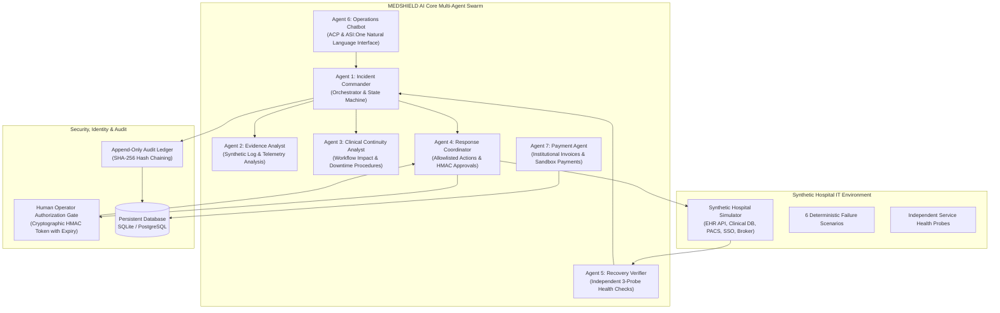

# MEDSHIELD AI — Multi-Agent Hospital IT Incident Response & Clinical Continuity Platform

MEDSHIELD AI is an enterprise-grade multi-agent coordination platform designed for hospital IT operations and clinical continuity. When simulated electronic health record (EHR) services or auxiliary clinical IT dependencies fail, MEDSHIELD AI coordinates incident detection, synthetic log investigation, clinical workflow impact mapping, human authorization gating, allowlist-only recovery execution, independent 3-probe health verification, and immutable audit logging.

> **CRITICAL SAFETY DIRECTIVE**: MEDSHIELD AI operates **strictly** against a deterministic synthetic hospital simulator. It never connects to real hospital infrastructure, never alters real clinical systems, never stores real patient records, and never executes real financial transfers.

---

## 1. System Architecture & Seven Logical Agents



### Logical Agent Responsibilities

| Agent # | Agent Name | Core Responsibility | Typed Contract Output |
| :--- | :--- | :--- | :--- |
| **Agent 1** | **Incident Commander** | Master orchestrator, state machine transitions, dispatching specialists, producing final incident reports, and integrating Fetch.ai ACP. | `IncidentStatus`, `IncidentReport` |
| **Agent 2** | **Evidence Analyst** | Inspects synthetic logs and telemetry, identifies likely root cause, scores confidence, and strictly separates observed facts from hypotheses. | `EvidenceReport` |
| **Agent 3** | **Clinical Continuity Analyst** | Maps affected services to fictional hospital departments (ED, ICU, OR, etc.), workflows (eMAR, CPOE, PACS), and activates curated, versioned downtime protocols. | `ClinicalImpactReport` |
| **Agent 4** | **Response Coordinator** | Enforces an explicit allowlist of recovery actions, validates HMAC approval tokens, checks replay protection, and executes actions on the simulator. | `ActionExecutionResult` |
| **Agent 5** | **Recovery Verifier** | Performs independent health probes requiring **3 consecutive successful checks** to declare recovery. Resets count on any failed or unverified check. | `VerificationResult` |
| **Agent 6** | **Hospital Operations Chatbot** | Answers authorized natural-language questions regarding live incident status, evidence, clinical impact, recovery progress, and audit history. | `ChatResponse` |
| **Agent 7** | **Payment Agent** | Manages synthetic institutional service invoices and sandbox payment workflows with strict idempotency, spend limits, and reconciliation. | `PaymentResult` |

---

## 2. Incident State Machine

The Incident Commander drives a formal, strictly validated state machine:

```
[NORMAL_MONITORING]
        │ (telemetry anomaly / log error detected)
        ▼
[INCIDENT_DETECTED]
        │ (specialist dispatch: Evidence & Clinical Continuity)
        ▼
[INVESTIGATING]
        │ (recovery plan proposed & HMAC token issued)
        ▼
[AWAITING_APPROVAL] ──(Operator Rejection / Expired Token)──► [ESCALATED]
        │ (Valid Human Operator Approval Granted)
        ▼
[RECOVERY_IN_PROGRESS] ──(Simulator Execution Error)─────────► [FAILED]
        │ (Action executed on simulator)
        ▼
[VERIFYING] ──────────(Health Probe Failure / Persistent Outage)──► [ESCALATED]
        │ (3 Consecutive Independent Successful Probes)
        ▼
[RECOVERED]
        │ (Incident closed, report archived)
        ▼
[NORMAL_MONITORING]
```

---

## 3. Synthetic Hospital Simulator & Scenarios

The simulator models an acute care hospital facility:
- **Departments**: Emergency Department & Level 1 Trauma (ED), Intensive Care Unit (ICU), Surgical Suite & Operating Theatres (OR), Inpatient Central Pharmacy, Diagnostic Imaging & Radiology, Inpatient Medical-Surgical Units.
- **Clinical Workflows**: Electronic Medication Administration Record (eMAR), Computerized Physician Order Entry (CPOE), Picture Archiving and Communication System (PACS), Patient Identity & Admission Discharge Transfer (ADT).
- **Curated Downtime Procedures**:
  - `DP-MAR-01 (v2.4)`: Bedside dual RN paper flowsheet verification.
  - `DP-CPOE-02 (v3.1)`: Multi-copy carbonless orders & physical unit runner dispatch.
  - `DP-PACS-03 (v1.8)`: Local scanner console viewing & emergency DICOM disc burning.
  - `DP-ADT-04 (v2.0)`: Pre-printed downtime wristbands & manual census logs.

### 6 Deterministic Failure Scenarios

1. `EHR_APP_OUTAGE`: Container process crash / OOM. Remediated by `RESTART_SERVICE`.
2. `DB_CONNECTION_FAILURE`: PostgreSQL connection pool exhaustion. Remediated by `FLUSH_CONNECTION_POOL`.
3. `NETWORK_TIMEOUT`: DICOM PACS route flapping / packet drop. Remediated by `FAILOVER_DATABASE`.
4. `AUTH_SERVICE_FAILURE`: Expired OAuth/SAML signing certificate. Remediated by `ROTATE_AUTH_KEYS`.
5. `RANSOMWARE_SIMULATION`: High file-entropy changes detected on isolated canary volume. Remediated by `ISOLATE_AND_RESTORE_HOST`.
6. `TELEMETRY_SPOOFING`: Ingestion queue corrupted with invalid HMAC checksums. Remediated by `RESYNC_TELEMETRY_STREAM`.

---

## 4. Cryptographic Security & Audit Hash Chain

- **HMAC-SHA256 Authorization Tokens**: Every recovery proposal generates a cryptographically bound token:
  $$\text{HMAC-SHA256}(K, \text{incident\_id} \parallel \text{action} \parallel \text{service} \parallel \text{expires\_at})$$
  Expired tokens, altered incident IDs, or replayed tokens are blocked before execution.
- **Tamper-Evident Audit Ledger**: Every significant action (incident started, evidence gathered, approval granted, action executed, verification probe, payment cleared) is logged in an append-only table where:
  $$H_i = \text{SHA-256}(\text{EventData}_i \parallel H_{i-1})$$
  The database verifies the entire cryptographic chain at any time via `AuditLogger.verify_audit_chain()`.

---

## 5. Fetch.ai Agent Chat Protocol (ACP) & ASI:One Discovery

MEDSHIELD AI implements the official Fetch.ai **Agent Chat Protocol (ACP) v0.3.0** via `uagents_core.contrib.protocols.chat`.

### Message Exchange Flow
1. External user or ASI:One sends `ChatMessage` with payload `[TextContent(text="...")]`.
2. Adapter immediately sends `ChatAcknowledgement` matching `msg_id`.
3. Adapter routes query to `HospitalOperationsChatbot` (verifying operator authorization and accessing shared incident state).
4. Adapter packages structured response into an outbound `ChatMessage` with attribution metadata.

### Exact Manual Instructions to Connect to Agentverse & ASI:One
To connect your running instance to Fetch.ai Agentverse and enable discovery in ASI:One:
1. Log in to [Agentverse.ai](https://agentverse.ai) with your Fetch.ai wallet or credentials.
2. Navigate to **Agents** > **My Agents** > **Create Agent**.
3. Select **Mailbox** mode to create a persistent cloud message relay for your agent.
4. Copy your **Mailbox API Key** and set it in your `.env` file:
   ```bash
   AGENT_MAILBOX_KEY=your-actual-agentverse-mailbox-key
   AGENTVERSE_API_KEY=your-actual-agentverse-api-key
   ```
5. Start the Fetch.ai agent runner:
   ```powershell
   .\.venv\Scripts\python.exe scripts/run_agent.py
   ```
6. On the Agentverse dashboard, verify that your agent's Almanac address appears with status **Active (Connected via Mailbox)**.
7. Open [ASI:One](https://asi1.ai) and query your agent by address or registered service title:
   > *"What clinical workflows are affected by the current hospital EHR outage?"*

---

## 6. Local Setup and Reproduction

### Prerequisites
- Python 3.12+ (64-bit)
- PowerShell (Windows) or Bash (Linux/macOS)
- Git

### Windows PowerShell Quickstart
```powershell
# 1. Clone repository and navigate to folder
cd c:\Users\Other User\Desktop\medshield

# 2. Virtual environment setup (already established in .venv)
.\.venv\Scripts\Activate.ps1

# 3. Run full automated test suite
.\.venv\Scripts\pytest.exe -v

# 4. Run the live end-to-end multi-agent demonstration script
$env:PYTHONPATH="src"
.\.venv\Scripts\python.exe scripts/demo_walkthrough.py

# 5. Start the FastAPI REST API Server (port 8000)
.\.venv\Scripts\python.exe scripts/run_server.py
```

### Linux / macOS Quickstart
```bash
python3.12 -m venv .venv
source .venv/bin/activate
pip install -r requirements.txt
pytest -v
PYTHONPATH=src python scripts/demo_walkthrough.py
python scripts/run_server.py
```

---

## 7. Cloud Deployment Guide (Docker & Docker Compose)

The production configuration uses Docker Compose with PostgreSQL 16 for persistent cloud state:

```bash
# Start all three production services (Database, API, Fetch.ai Agent)
docker compose up -d --build

# Inspect service logs
docker compose logs -f

# Verify API healthcheck endpoint
curl -f http://localhost:8000/healthz
```

---

## 8. Verified Test Results & Acceptance Checklist

All 50 unit, contract, state machine, and integration tests pass cleanly:

```
============================= test session starts =============================
platform win32 -- Python 3.12.10, pytest-9.1.1, pluggy-1.7.0
rootdir: C:\Users\Other User\Desktop\medshield
configfile: pyproject.toml
collected 50 items

tests\test_api.py .....                                                  [ 10%]
tests\test_chatbot.py .....                                              [ 20%]
tests\test_evidence_and_continuity.py ......                             [ 32%]
tests\test_incident_commander.py ..                                      [ 36%]
tests\test_integration.py ..                                             [ 40%]
tests\test_payment.py .......                                            [ 54%]
tests\test_response_and_verifier.py .......                              [ 68%]
tests\test_schemas.py ......                                             [ 80%]
tests\test_simulator.py ..........                                       [100%]

============================= 50 passed in 1.44s ==============================
```

### Acceptance Checklist

- [x] Canonical typed schemas for all 7 agents and system events.
- [x] Agent 1 (Incident Commander) entry orchestrator & state machine.
- [x] Agent 2 (Evidence Analyst) log/telemetry root-cause evaluation.
- [x] Agent 3 (Clinical Continuity Analyst) department & workflow downtime mapping.
- [x] Agent 4 (Response Coordinator) allowlist enforcement & HMAC approval gates.
- [x] Agent 5 (Recovery Verifier) 3 consecutive independent probe verification.
- [x] Agent 6 (Hospital Operations Chatbot) natural-language authorized querying.
- [x] Agent 7 (Payment Agent) sandbox invoice & idempotency workflow.
- [x] Synthetic Hospital Simulator with all 6 repeatable failure scenarios.
- [x] Append-only cryptographic audit hash chaining.
- [x] Fetch.ai ACP v0.3.0 adapter (`ChatMessage`, `ChatAcknowledgement`, `TextContent`).
- [x] FastAPI REST endpoints & healthcheck probe (`/healthz`).
- [x] Dockerfile & Docker Compose deployment configuration.
- [x] Live end-to-end demonstration script (`scripts/demo_walkthrough.py`).
